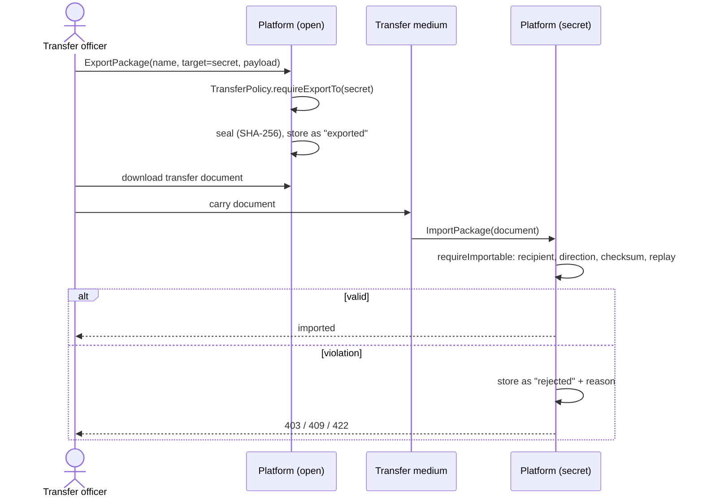

# Neko Service Platform — NAF v4 Description

Architecture description following the NATO Architecture Framework v4 grid
(viewpoints C = concepts, L = logical, P = physical resources, S = services,
A = meta-data).

## A1 — Meta-data

| Item | Value |
| --- | --- |
| Architecture | Neko Service Platform |
| Scope | One platform instance per security domain, plus the transfer path between them |
| Status | Baseline (as built) |
| Sources | `backend/source/neko/service/platform`, `frontend/`, `approuter/`, `mta.yaml` |

## C1 — Capability taxonomy

```text
Service platform operations
├── C1.1 Service catalogue management
│   ├── register / describe services per domain
│   ├── life cycle: registered → active ⇄ suspended → retired
│   └── enforce hosting rule (classification ≤ platform domain)
├── C1.2 Service health monitoring
│   ├── on-demand probe
│   └── periodic probe (background worker)
├── C1.3 Cross-domain data transfer
│   ├── seal and export packages to higher domains
│   ├── verify and import packages from lower domains
│   └── audit refused packages (wrong recipient, downward flow, tampering, replay)
└── C1.4 Platform administration
    ├── web cockpit (SAP Fiori 3) and status page
    ├── command-line interface
    └── layered configuration (file → env → VCAP_SERVICES)
```

## C2 — Enterprise vision / principles

1. **No write-down.** Information never flows to a lower classification.
2. **Compile-time domain.** A binary is built for exactly one domain.
3. **Self-contained per domain.** No runtime dependency on another domain or
   on the internet (UI5 is served from the platform itself).
4. **Auditability.** Every life-cycle change and every transfer — including
   refused ones — is recorded as an event and, for transfers, persisted.

## L1 — Node types

| Node | Role |
| --- | --- |
| Platform node (open) | Hosts open services; can export to all higher domains |
| Platform node (restricted, confidential) | Imports from lower, exports to higher domains |
| Platform node (secret) | Imports only; export is disabled by policy |
| Transfer medium | Carries transfer documents (`neko-transfer/1`) upwards, e.g. data diode or removable media |
| Operator workstation | Browser (Fiori cockpit) or shell (CLI) |

## L2 — Logical scenario: package from open to secret



## L4 — Logical activities

| Activity | Performed by | Use case |
| --- | --- | --- |
| Register service | Platform admin | `ManageServicesUseCase.register` |
| Change life cycle | Platform admin | `activate`, `suspend`, `retire`, `remove` |
| Probe health | Admin / background worker | `CheckServiceHealthUseCase` |
| Export package | Transfer officer (lower domain) | `TransferPackagesUseCase.exportPackage` |
| Import package | Transfer officer (higher domain) | `TransferPackagesUseCase.importPackage` |
| Review | Viewer | `PlatformOverviewUseCase`, lists |

## L7 — Logical data model

| Entity | Key attributes |
| --- | --- |
| PlatformService | id, name (unique), classification, endpoint (base URL, health path), status, health |
| TransferPackage | id, name, direction, source/target domain, status, payload, checksum, reason, createdBy |
| PlatformEvent | type, subject, actor, message, timestamp (published, not persisted) |
| SecurityDomain | open < restricted < confidential < secret |

## L8 — Logical constraints

- `classification(service) ≤ domain(platform)`
- export allowed iff `domain ≠ secret` and `target > domain`
- import allowed iff `domain ≠ open`, `target = domain`, `source < domain`,
  checksum valid and id not already imported/exported
- only retired services may be removed; retired is final

## S1 — Service taxonomy

| Service | Interface | Consumers |
| --- | --- | --- |
| Platform REST API | `/rest/v1` (JSON) | scripts, other systems |
| Platform OData v4 | `/odata/v4/platform` | Fiori cockpit |
| Status page | `/status` (HTML) | operators |
| Health / info | `/health`, `/api/v1/info` | load balancer, monitoring |
| CLI | `platform-<domain> <command>` | operators on the host |
| Health gateway | outbound HTTP GET to registered services | — |

## P1 — Resource types

| Resource | Technology |
| --- | --- |
| Backend | D, vibe.d 0.10 (vibe-http), dyaml; one executable per domain |
| Frontend | OpenUI5 1.120 (LTS), SAP Fiori 3 theme, OData v4 model |
| Approuter | `@sap/approuter` (Node.js), XSUAA |
| Storage | JSON documents per collection (`<dataDir>/<domain>/*.json`) or memory |
| Deployment | MTA (`mta.yaml`), Cloud Foundry `binary_buildpack` |

## P2 — Resource structure

```text
CF space (one per domain)
├── neko-platform-approuter   ── XSUAA (neko-platform-xsuaa)
│        │ destination neko-platform-srv (forwardAuthToken)
└── neko-platform-srv (./platform, built with --config=<domain>)
         ├── user-provided service neko-platform-config (VCAP overrides)
         └── data/<domain>/{services,transfers}.json
```

Off-cloud, the backend can listen on a Unix domain socket instead of TCP
(`transport: unix`), e.g. behind a local reverse proxy in an air-gapped domain.
