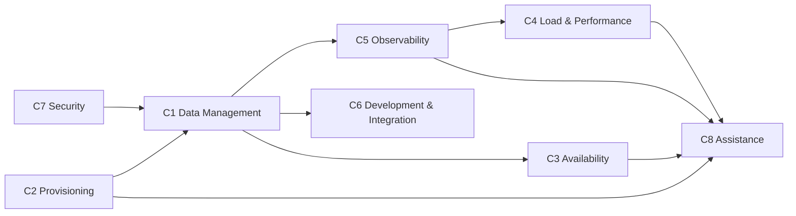
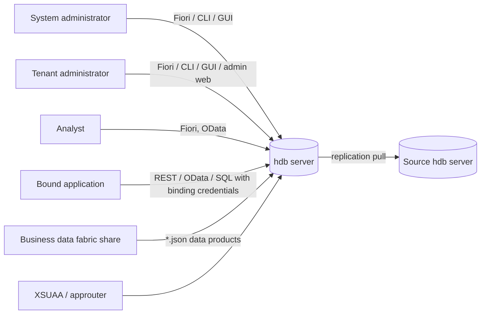
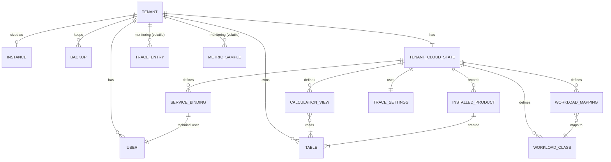

# NAF v4 Architecture Description — Database Service (hdb)

> NATO Architecture Framework v4 (NAF v4) description of `neko.database` (hdb), a HANA-Cloud-like in-memory column
> database of the neko platform. It covers multi-tenant SQL storage with backups, replication and logs, and the cloud
> functions of a managed database service: instance provisioning, workload management, monitoring and tracing,
> intelligent advisors, calculation views, application bindings, data products and a virtual assistant. Interfaces:
> REST, OData v4 (SAP Fiori 3), an admin web console, a Unix socket, a CLI and a GtkD desktop client.

---

## 1. NAF v4 Grid Mapping

| NAF View | Viewpoint | Covered Below |
|---|---|---|
| **NCV** – Capability View | C1 Capability Taxonomy, C2 Enterprise Vision, C3 Capability Dependencies | §2 |
| **NSV** – Service View | NSOV-1 Service Taxonomy, NSOV-2 Service Definitions, NSOV-3 Service Interfaces | §3 |
| **NOV** – Operational View | NOV-1 Concept, NOV-2 Node Connectivity, NOV-5 Operational Activities | §4 |
| **NLV** – Logical View | NLV-1 Logical Data Model, NLV-2 Logical Components, NLV-6 State Transitions | §5 |
| **NPV** – Physical View | NPV-1 Physical Deployment, NPV-2 Configuration | §6 |
| **NIV** – Information View | NIV-1 Information Structure, NIV-2 Business Rules | §7 |
| **Architecture decisions** | — | §8 |
| **Traceability** | capabilities → services → components | §9 |

---

## 2. Capability View (NCV)

### C1 – Capability Taxonomy

```
C0  Managed Column Database
├── C1  Data Management
│   ├── C1.1  SQL storage and query (column store, dictionary + delta merge, joins, grouping, procedures)
│   ├── C1.2  Table storage types (memory, file, JSON, binary, BSON)
│   └── C1.3  Transactions and durability (statement log, checkpoints)
├── C2  Provisioning
│   ├── C2.1  Create / delete instances
│   ├── C2.2  Size and performance class (memory, storage, vCPU ratio, NSE, ECN)
│   └── C2.3  Start / stop instances
├── C3  Availability
│   ├── C3.1  Backup and restore (manual, scheduled, safety backups)
│   ├── C3.2  Backup retention up to 7 months
│   └── C3.3  Replication between servers
├── C4  Load and Performance
│   ├── C4.1  Multicore processing (background merge, parallel statistics)
│   ├── C4.2  Workload management (classes, mappings, limits)
│   └── C4.3  Intelligent advisors (Index, NSE, Partition, Performance Class, ECN)
├── C5  Observability
│   ├── C5.1  Monitoring (metrics, table accesses)
│   ├── C5.2  Tracing (SQL, expensive, errors, violations)
│   ├── C5.3  Issue summaries (root cause, resolution)
│   └── C5.4  Audit, event and application logs
├── C6  Application Development and Integration
│   ├── C6.1  OData v4 exposure of tables and calculation views
│   ├── C6.2  Calculation views (analytic modeling)
│   ├── C6.3  Application bindings (technical users, credentials)
│   └── C6.4  Data products (business data fabric)
├── C7  Security
│   ├── C7.1  Tenants, users, roles, table grants (time-limited)
│   ├── C7.2  Allowed networks, trusted proxies
│   └── C7.3  XSUAA-protected entry point on SAP BTP
└── C8  Administration Assistance
    ├── C8.1  Virtual assistant (single and batch tasks)
    └── C8.2  Guided assistance
```

### C2 – Enterprise Vision

Provide a self-contained, deployable column database that offers the operating model of a managed cloud database —
self-service instances, governed workloads, observability with automated diagnosis and advisors — to the services of
the neko platform, on a developer machine, in containers, on Kubernetes or on SAP BTP Cloud Foundry, without an
external database product.

Goals: (G1) one binary per role (server, CLI, GUI); (G2) every interface sees the same secured core; (G3) every
administrative action is audited; (G4) recommendations are explainable and never applied silently.

### C3 – Capability Dependencies



Advisors (C4.3) need monitoring data (C5.1/C5.2); the assistant (C8) only orchestrates other capabilities and has
no rights of its own.

---

## 3. Service View (NSV)

### NSOV-1 – Service Taxonomy

| ID | Service | Consumers |
|---|---|---|
| S1 | SQL Service | applications, Fiori, CLI, GUI, admin web |
| S2 | Table OData Service | Fiori, applications |
| S3 | Tenant & Access Service | administrators |
| S4 | Backup Service | tenant administrators, schedule worker |
| S5 | Replication Service | replica servers |
| S6 | Instance Service | system administrators |
| S7 | Workload Service | tenant administrators, SQL path (enforcement) |
| S8 | Monitoring & Diagnosis Service | tenant administrators, operators |
| S9 | Advisor Service | tenant and system administrators |
| S10 | Calculation View Service | analysts, applications |
| S11 | Binding Service | application operators |
| S12 | Data Product Service | data engineers |
| S13 | Assistant Service | all authenticated users |
| S14 | Cloud OData Service | Fiori |
| S15 | Log Service | administrators, auditors |

### NSOV-2 – Service Definitions

| ID | Port (D interface) | Implementation | Contract |
|---|---|---|---|
| S1 | `ISqlUseCase` | `MonitoredDatabases` → `AuditedDatabases` → `TenantDatabases` → `SqlService` | One statement or transaction step; permissions per table |
| S4 | `IBackupUseCase` | `BackupService` | Create, restore, upload, schedule, `updateRetention(0..215)` |
| S6 | `IInstanceUseCase` | `InstanceService` | Instance = tenant + sizing; validated sizing, 404/409 |
| S7 | `IWorkloadUseCase` | `WorkloadService` | Classes and mappings; enforcement in S1 |
| S8 | `IMonitoringUseCase` | `MonitoringService` | Overview, traces, trace settings, table accesses, issue summary |
| S9 | `IAdvisorUseCase`, `IInstanceUseCase.instanceAdvisors` | `AdvisorService`, `InstanceService` | Recommendations; read-only |
| S10 | `ICalcViewUseCase` | `CalcViewService` | Saved after trial run; queries with caller permissions |
| S11 | `IBindingUseCase` | `BindingService` | Technical user + credentials, password once |
| S12 | `IDataProductUseCase` | `DataProductService` over `IDataProductCatalog` | Install/uninstall atomically per product |
| S13 | `IAssistantUseCase` | `AssistantService` | ≤ 10 tasks per message, each audited |
| S14 | — | `CloudODataController` | OData 4.0 CSDL depending on login |

### NSOV-3 – Service Interfaces

| Interface | Protocol | Path / entry |
|---|---|---|
| REST v1 | HTTPS/JSON, Bearer | `/api/v1/*`, cloud: `/api/v1/cloud/instances`, `/workloads`, `/monitoring`, `/advisors`, `/views`, `/bindings`, `/dataproducts`, `/assistant`, `/backups/retention` |
| OData v4 (tables) | OData 4.0 | `/odata/v4` |
| OData v4 (cloud) | OData 4.0 | `/odata/v4/cloud` (entity sets, actions, function `IssueSummary()`) |
| Admin web | HTML (Diet), cookie | `/admin` |
| Unix socket | HTTP-like framing | `UNIX_SOCKET` path |
| CLI | process | `hdb-cli` (SQL shell), `hdb-cli cloud …` (REST) |
| GUI | process | `hdb-admin` (REST) |
| Embedded | D API | `neko.database.embedded` |

---

## 4. Operational View (NOV)

### NOV-1 – Concept

A system administrator provisions an instance per team or application and sizes it. The tenant administrator binds
applications, installs data products, models calculation views and defines workload classes. Applications use SQL,
REST or OData; analysts use the Fiori app. Operators watch Monitoring, read the automated issue summary and act on
advisor recommendations — directly or through the assistant ("merge delta; checkpoint; summarize issues").
Backups run on a schedule and are retained up to 7 months.

### NOV-2 – Operational Node Connectivity



### NOV-5 – Operational Activities

| Activity | Actor | Steps |
|---|---|---|
| A1 Provision instance | System admin | create (name, size, class, admin) → share admin credentials |
| A2 Scale instance | System admin | run Performance Class / ECN advisor → resize / change class / add ECN |
| A3 Bind application | Tenant admin | create binding → store credentials → configure application |
| A4 Model analytics | Analyst / admin | install data product → create calculation view → consume `CV_<name>` |
| A5 Govern workload | Tenant admin | create class → map users/roles → watch violations |
| A6 Diagnose | Operator | Monitoring → trace filter → issue summary → apply resolution |
| A7 Optimize | Operator | run advisors → apply recommendations (merge, partition plan, NSE plan) |
| A8 Protect data | Tenant admin | schedule + retention → manual backup before changes → restore if needed |

---

## 5. Logical View (NLV)

### NLV-1 – Logical Data Model



### NLV-2 – Logical Components

| Layer | Components |
|---|---|
| Domain | entities (`ColumnTable`, `Principal`, `DatabaseInstance`, `WorkloadClass`, `CalculationView`, `ServiceBinding`, `DataProduct`), types (`QueryResult`, `TraceEntry`, `MetricSample`, `Recommendation`, `IssueSummary`), services (`advisors`, `diagnosis`, `assistant`, `inspection`) |
| Ports | usecases (`ISqlUseCase`, `IBackupUseCase`, cloud use cases), repositories (`ICloudRepository`), storages (`ICloudStateStore`, `IMonitoringStore`), gateways (`IDataProductCatalog`), services (`IStatisticsSource`) |
| Application | `SqlService`, `TenantDatabases`, `AccessService`, `TenantService`, `BackupService`, `LogService`, audit decorators, cloud services, `CloudServices` composition |
| Persistence | table repositories, `FileBackupStore`, `CloudRepository`, file storages, records, mappers |
| Infrastructure | `DatabaseConfig`, `Workers`, `SecurityGate`, `OpensslCredentialCrypto`, `HttpReplicationClient`, `DataProductCatalog`, gateway |
| Presentation | REST, OData (tables, cloud), admin web, CLI, GtkD (models/views/controllers), Unix socket |

### NLV-6 – State Transitions

| Object | States | Transitions |
|---|---|---|
| Instance | creating → running ⇄ stopped → deleted | create, start, stop, delete (stops first) |
| Data product (per tenant) | available → installed → available | install (rollback on error), uninstall |
| Binding | — → active → revoked | create (user created), delete (user deleted) |
| Workload class | defined → mapped → defined → deleted | delete only without mappings |
| Statement (in S1) | admitted → executed → traced | rejected on concurrency/memory limit (429) |

---

## 6. Physical View (NPV)

### NPV-1 – Physical Deployment

| Target | Artifacts | Notes |
|---|---|---|
| Developer machine | `backend/build/hdb`, `hdb-cli`, `hdb-admin`; Fiori from `frontend/` at `/ui5/` | `dub build [--config=cli|gui]` |
| Container | `Containerfile` / `Dockerfile` (LDC build, Debian slim, non-root, volume `/app/data`) | Podman or Docker |
| Kubernetes | `k8s/configmap.yaml`, `secret.yaml`, `deployment.yaml` (+ PVC), `service.yaml` | one writer per volume |
| SAP BTP Cloud Foundry | `mta.yaml`: `hdb-srv` (binary buildpack), `hdb-approuter` (Fiori in `resources/`), `hdb-xsuaa`, `hdb-config` | `mbt build && cf deploy` |

### NPV-2 – Configuration

Precedence: code defaults → `backend/config/default.json` (`HDB_CONFIG`) → environment → `VCAP_SERVICES` (`hdb-config`).
Key settings: `port`, `mode`, `tenantsDir`, `usersFile`, `cloudFile`, `dataProductsDir`, `frontendDir`, `publicUrl`,
`region`, `monitorTickSeconds`, `backupTickSeconds`, `trustedProxies`, `unixSocket`. Secrets (initial admin passwords,
XSUAA credentials) come from the environment or service bindings, never from files in the repository.

---

## 7. Information View (NIV)

### NIV-1 – Information Structure

| Information | Store | Format | Lifetime |
|---|---|---|---|
| Tables | `data/tenants/<t>/` | statement log, per-table files | durable |
| Backups | `data/tenants/<t>/backups/*.hdbbak` | header + snapshot + SHA-256 | retention (count, ≤ 215 days) |
| Users, roles, tenants | `data/hdb-*.json` | JSON, 0600 | durable |
| Cloud state | `data/hdb-cloud.json` | JSON records (`formatVersion`) | durable |
| Traces, samples, accesses | memory (`MemoryMonitoringStore`) | ring buffers | until restart; samples 24 h |
| Logs | `data/logs/*.jsonl` | JSON lines | retention per log |
| Data products | built-in + `data/dataproducts/*.json` | JSON | external |

### NIV-2 – Business Rules

1. System administrators manage instances and tenants but never read tenant data (no table access, traces without statements).
2. Memory is 16–6144 GB in steps of 16 GB; storage ≥ 2 × memory and ≤ 32768 GB; at most 4 elastic compute nodes.
3. Backup retention is 0–215 days and applies only to scheduled and safety backups; the newest scheduled backup stays.
4. A workload class with mappings cannot be deleted; a user mapping beats a role mapping; ties go to the higher priority.
5. Concurrency and memory limits reject the statement (429); a timeout is recorded as a violation.
6. A calculation view is stored only if a trial query succeeds; filters may not contain `;` or comments.
7. Binding passwords are generated, returned once and never stored in clear text.
8. Data product installation is all-or-nothing per product; table names are `<id with _>__<table>`.
9. Trace statements never contain literal values.
10. Advisors and the assistant never bypass permission checks; every cloud action is audited.

---

## 8. Architecture Decisions

| ID | Decision | Rationale |
|---|---|---|
| AD1 | Hexagonal layout `domain / ports / application / persistence / infrastructure / presentation` | Adapters change without touching business rules; matches the platform skill layout |
| AD2 | Instance = tenant + sizing metadata | Reuses isolation, users, backups and deletion of tenants; no second lifecycle for data |
| AD3 | `MonitoredDatabases` as outermost `ISqlUseCase` decorator | Every adapter is measured and governed without code changes in adapters |
| AD4 | Monitoring data in memory | Low overhead; durable history is out of scope for an embedded engine |
| AD5 | Rule-based assistant and diagnosis | Deterministic, explainable, offline; no data leaves the server |
| AD6 | Advisors recommend, never execute | Recommendations for unsupported features (indexes, partitions, NSE) stay honest |
| AD7 | Separate OData service `/odata/v4/cloud` with login-dependent metadata | Fiori binds cloud objects and calculation views without colliding with table entity sets |
| AD8 | Typed configuration with VCAP precedence | Same binary locally, in containers and on BTP |
| AD9 | GUI and CLI cloud commands use REST only | Same permissions and audit as every client; no server code in clients |
| AD10 | Approuter protects UI with XSUAA, database keeps its own authentication | Database identities and table grants stay authoritative |

---

## 9. Traceability Matrix

| Capability | Service | Components | Interfaces |
|---|---|---|---|
| C1.1 SQL | S1 | `SqlService`, `TenantDatabases`, `MonitoredDatabases` | REST `/api/v1/sql`, OData, Unix, CLI |
| C2.1–C2.3 Provisioning | S6 | `InstanceService`, `TenantService`, `CloudRepository` | `/api/v1/cloud/instances`, OData `Instances`, CLI `instances`, GUI Instances |
| C3.1–C3.2 Backup & retention | S4 | `BackupService`, `FileBackupStore`, `Workers` | `/api/v1/backups*`, `/backups/retention`, CLI `backups retention`, GUI Retention… |
| C3.3 Replication | S5 | `TenantReplication`, `HttpReplicationClient` | `/api/v1/replication*` |
| C4.1 Multicore | S1 | background merge thread, `SqlService.parallelStats` | Monitoring (cores) |
| C4.2 Workload | S7 | `WorkloadService`, `MonitoredDatabases`, `resolveWorkload` | `/api/v1/workloads/*`, OData `WorkloadClasses`, CLI `workloads` |
| C4.3 Advisors | S9 | `domain.services.advisors`, `AdvisorService` | `/api/v1/advisors*`, OData `Recommendations`, `RunAdvisors` |
| C5.1–C5.2 Monitoring & tracing | S8 | `MonitoredDatabases`, `MemoryMonitoringStore`, `MonitoringService` | `/api/v1/monitoring*`, OData `Traces`, `Metrics`, `TableAccess` |
| C5.3 Issue summaries | S8 | `domain.services.diagnosis` | `/api/v1/monitoring/issues`, OData `IssueSummary()` |
| C6.1 OData | S2, S14 | `ODataController`, `CloudODataController` | `/odata/v4`, `/odata/v4/cloud` |
| C6.2 Calculation views | S10 | `domain.entities.calcview`, `CalcViewService` | `/api/v1/views*`, OData `CV_<name>` |
| C6.3 Bindings | S11 | `BindingService`, `AccessService` | `/api/v1/bindings`, OData `Bindings` |
| C6.4 Data products | S12 | `DataProductService`, `DataProductCatalog` | `/api/v1/dataproducts*`, OData `DataProducts`, `InstallDataProduct` |
| C7 Security | S3 | `SecurityGate`, `AccessService`, approuter/XSUAA | `/api/v1/auth*`, `/api/v1/users*` |
| C8 Assistance | S13 | `domain.services.assistant`, `AssistantService` | `/api/v1/assistant`, OData `Ask`, CLI `ask`, Fiori/GUI Assistant |
