# UML — neko.database (hdb)

Diagrams in Mermaid. They show the structure after the redesign into the hexagonal layout
(`backend/source/neko/database/{domain,ports,application,persistence,infrastructure,presentation}`) and the cloud
functions. Names are D module and type names; fields are abbreviated to what matters for the design.

## Component Diagram — Hexagonal Architecture

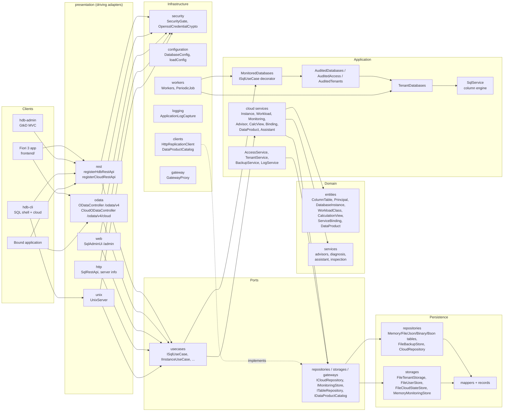

## Class Diagram — Cloud Domain Entities

```mermaid
classDiagram
    class DatabaseInstance {
        +string name
        +string description
        +PerformanceClass performanceClass
        +size_t memoryGb
        +size_t storageGb
        +bool nseEnabled
        +size_t ecnNodes
        +string region
        +string version_
        +vcpus() size_t
    }
    class WorkloadClass {
        +string name
        +int priority
        +size_t statementTimeoutSeconds
        +size_t statementMemoryLimitMb
        +size_t totalStatementLimit
        +size_t statementThreadLimit
        +bool enabled
    }
    class WorkloadMapping {
        +string name
        +string workloadClass
        +string userName
        +string roleName
    }
    class CalculationView {
        +string name
        +CalcViewType viewType
        +string baseTable
        +CalcJoin[] joins
        +CalcAttribute[] attributes
        +CalcMeasure[] measures
        +string filter
    }
    class CalcJoin {
        +string table
        +bool left
        +string leftColumn
        +string rightColumn
    }
    class CalcAttribute {
        +string column
        +string label
    }
    class CalcMeasure {
        +string column
        +Aggregation aggregation
        +string label
    }
    class ServiceBinding {
        +string name
        +string application
        +string user
        +string role
    }
    class BindingCredentials {
        +string host
        +ushort port
        +string odataUrl
        +string user
        +string password
    }
    class DataProduct {
        +string id
        +string version_
        +DataProductTable[] tables
    }
    class DataProductTable {
        +string name
        +DataProductColumn[] columns
        +string[][] rows
    }
    class InstalledProduct {
        +string productId
        +string prefix
        +string[] tables
    }
    class TraceEntry {
        +ulong id
        +string kind
        +string statement
        +double durationMs
        +string error
    }
    class MetricSample {
        +string time
        +size_t statements
        +double avgMs
        +ulong memoryBytes
        +double cpuPercent
    }
    class Recommendation {
        +AdvisorKind advisor
        +Severity severity
        +string target
        +string action
    }
    class IssueSummary {
        +IssueGroup[] groups
        +string rootCause
        +string resolution
        +string text
    }

    CalculationView *-- CalcJoin
    CalculationView *-- CalcAttribute
    CalculationView *-- CalcMeasure
    WorkloadMapping --> WorkloadClass : workloadClass
    DataProduct *-- DataProductTable
    InstalledProduct ..> DataProduct : productId
    ServiceBinding ..> BindingCredentials : issued once
    IssueSummary ..> TraceEntry : summarizes

    class PerformanceClass {
        <<enumeration>>
        compute
        memory
        highMemory
    }
    class AdvisorKind {
        <<enumeration>>
        index
        nse
        partition
        performanceClass
        ecn
    }
    class Aggregation {
        <<enumeration>>
        sum
        count
        avg
        min
        max
        countDistinct
    }
    class InstanceStatus {
        <<enumeration>>
        creating
        running
        stopped
        error
    }
```

## Class Diagram — Domain Services

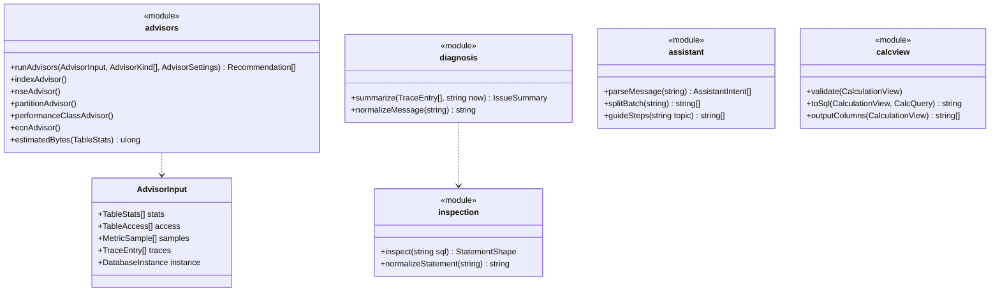

## Class Diagram — Use Cases, Ports and Services

```mermaid
classDiagram
    class ISqlUseCase {
        <<interface>>
        +execute()
        +executeIn()
        +listTables()
        +stats()
        +mergeDelta()
        +checkpoint()
    }
    class IBackupUseCase {
        <<interface>>
        +create()
        +restore()
        +schedule()
        +updateSchedule()
        +updateRetention(int)
    }
    class IInstanceUseCase {
        <<interface>>
        +listInstances()
        +createInstance()
        +updateInstance()
        +startInstance()
        +stopInstance()
        +deleteInstance()
        +instanceMetrics()
        +instanceAdvisors()
    }
    class IWorkloadUseCase {
        <<interface>>
        +listClasses()
        +saveClass()
        +deleteClass()
        +listMappings()
        +saveMapping()
        +deleteMapping()
    }
    class IMonitoringUseCase {
        <<interface>>
        +overview()
        +traces()
        +configureTrace()
        +clearTraces()
        +tableAccess()
        +issueSummary()
    }
    class IAdvisorUseCase {
        <<interface>>
        +runAdvisors()
        +recommendations()
    }
    class ICalcViewUseCase {
        <<interface>>
        +listViews()
        +saveView()
        +deleteView()
        +queryView()
        +viewSql()
    }
    class IBindingUseCase {
        <<interface>>
        +listBindings()
        +createBinding()
        +deleteBinding()
    }
    class IDataProductUseCase {
        <<interface>>
        +catalog()
        +install()
        +uninstall()
    }
    class IAssistantUseCase {
        <<interface>>
        +ask(Principal, string) AssistantReply
    }
    class ICloudRepository {
        <<interface>>
        +instances()
        +saveInstance()
        +tenantState()
        +saveTenantState()
    }
    class IMonitoringStore {
        <<interface>>
        +appendTrace()
        +traces()
        +appendSample()
        +countAccess()
        +access()
    }
    class IDataProductCatalog {
        <<interface>>
        +products()
        +product(id)
    }
    class IStatisticsSource {
        <<interface>>
        +openTenants()
        +statsOf(tenant)
    }

    class MonitoredDatabases
    class InstanceService
    class WorkloadService
    class MonitoringService
    class AdvisorService
    class CalcViewService
    class BindingService
    class DataProductService
    class AssistantService
    class CloudServices {
        +MonitoredDatabases sql
        +InstanceService instances
        +AssistantService assistant
    }
    class TenantDatabases
    class CloudRepository
    class MemoryMonitoringStore
    class DataProductCatalog

    MonitoredDatabases ..|> ISqlUseCase
    MonitoredDatabases --> ISqlUseCase : inner (audited)
    MonitoredDatabases --> ICloudRepository
    MonitoredDatabases --> IMonitoringStore
    TenantDatabases ..|> ISqlUseCase
    TenantDatabases ..|> IBackupUseCase
    TenantDatabases ..|> IStatisticsSource
    InstanceService ..|> IInstanceUseCase
    InstanceService --> ITenantUseCase
    WorkloadService ..|> IWorkloadUseCase
    MonitoringService ..|> IMonitoringUseCase
    AdvisorService ..|> IAdvisorUseCase
    CalcViewService ..|> ICalcViewUseCase
    BindingService ..|> IBindingUseCase
    BindingService --> IAccessUseCase
    DataProductService ..|> IDataProductUseCase
    DataProductService --> IDataProductCatalog
    AssistantService ..|> IAssistantUseCase
    AssistantService --> IInstanceUseCase
    AssistantService --> IMonitoringUseCase
    AssistantService --> IAdvisorUseCase
    CloudServices *-- MonitoredDatabases
    CloudServices *-- InstanceService
    CloudServices *-- AssistantService
    CloudRepository ..|> ICloudRepository
    MemoryMonitoringStore ..|> IMonitoringStore
    DataProductCatalog ..|> IDataProductCatalog
```

## State Diagram — Instance Lifecycle

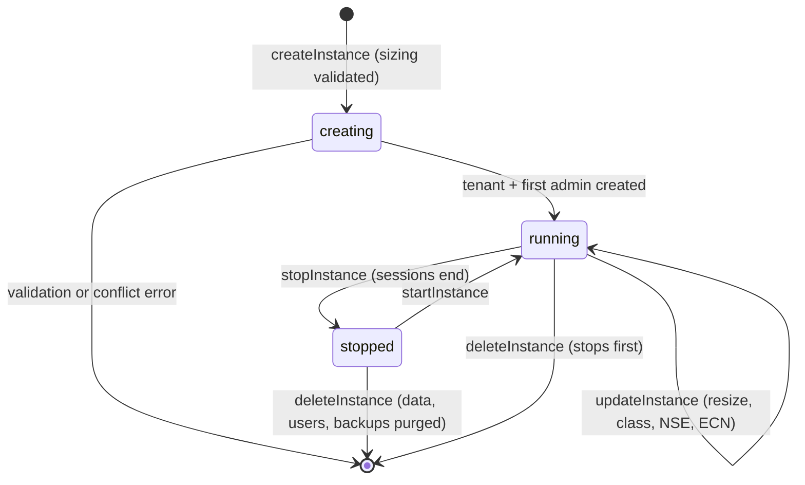

## Activity Diagram — Statement through `MonitoredDatabases`

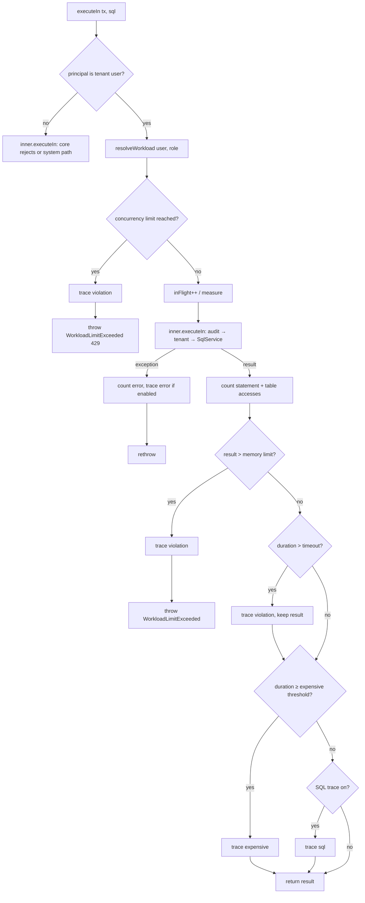

## Activity Diagram — Install a Data Product

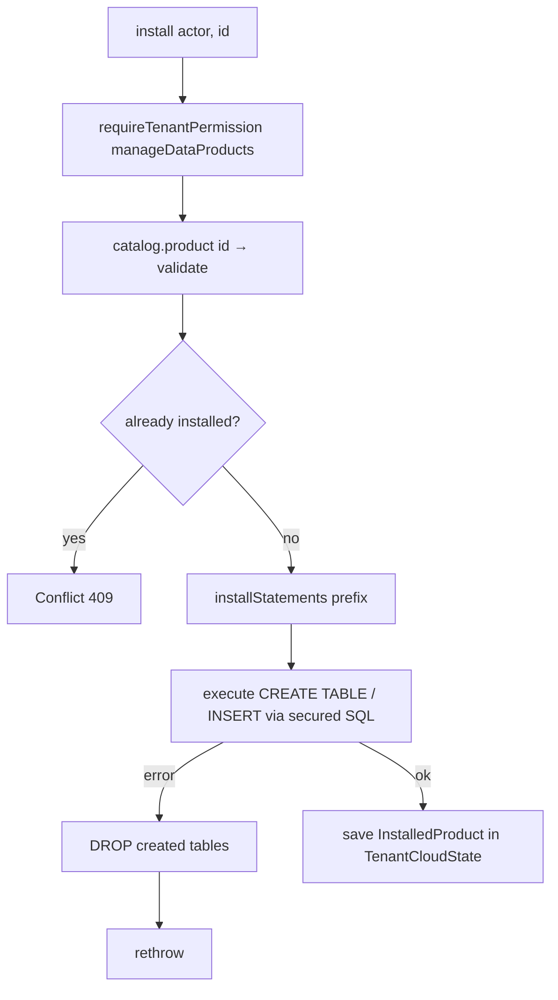

## Sequence Diagram — Fiori queries a Calculation View over OData

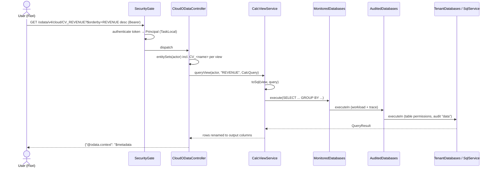

## Sequence Diagram — Assistant batch

```mermaid
sequenceDiagram
    actor A as Admin
    participant R as REST /api/v1/assistant
    participant S as AssistantService
    participant P as domain.assistant.parseMessage
    participant M as MonitoringService
    participant B as IBackupUseCase
    A->>R: {"message": "status; create a backup labeled nightly"}
    R->>S: ask(actor, message)
    S->>P: parseMessage
    P-->>S: [instanceStatus, createBackup("nightly")]
    S->>M: overview(actor)
    M-->>S: MonitoringOverview
    S->>B: create("nightly")
    B-->>S: BackupInfo
    S-->>R: AssistantReply {text, steps[2], suggestions}
    R-->>A: 200 JSON
```

## Sequence Diagram — System administrator creates an instance with the CLI

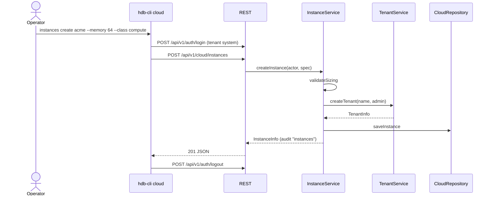

## Component Diagram — GtkD client (MVC)

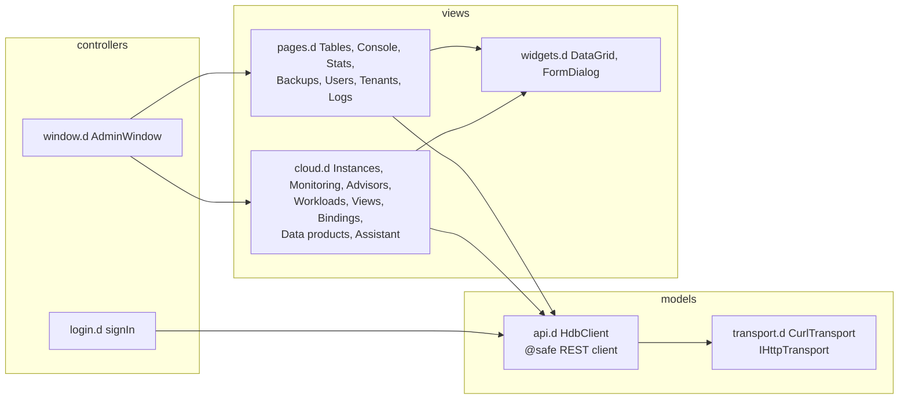

## Deployment Diagram — SAP BTP (Cloud Foundry) and containers

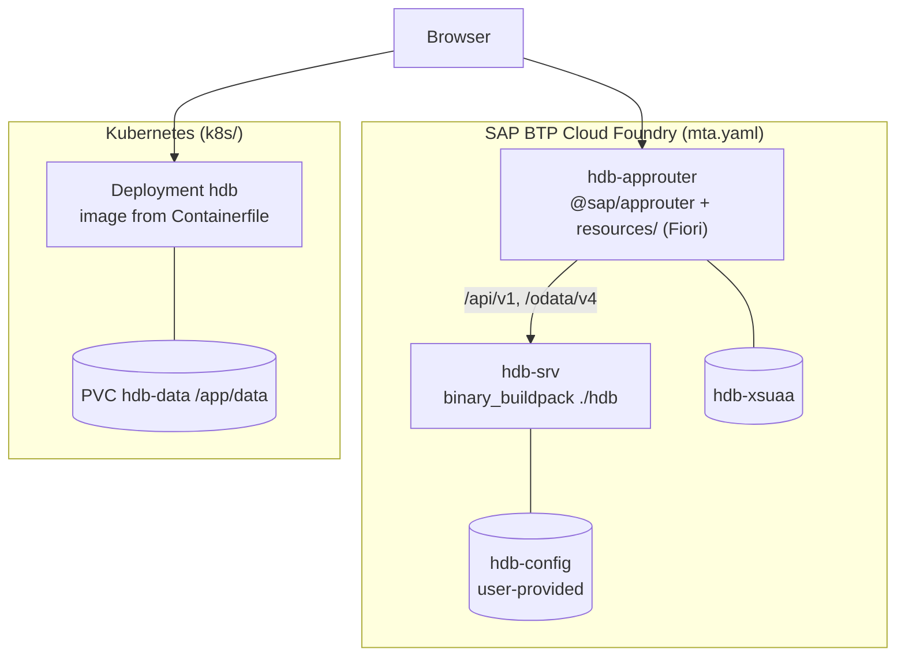
