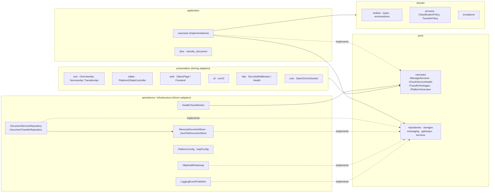
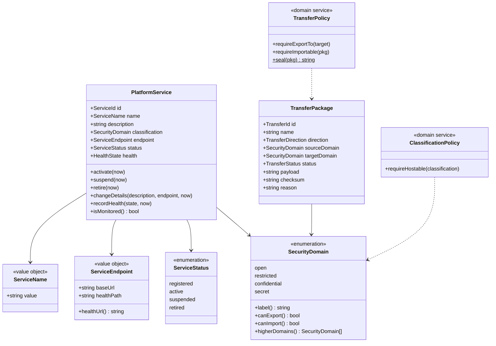
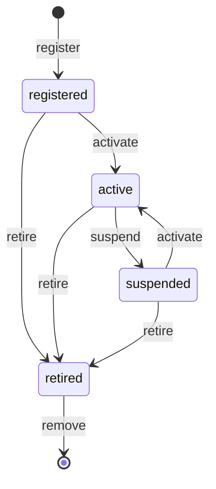
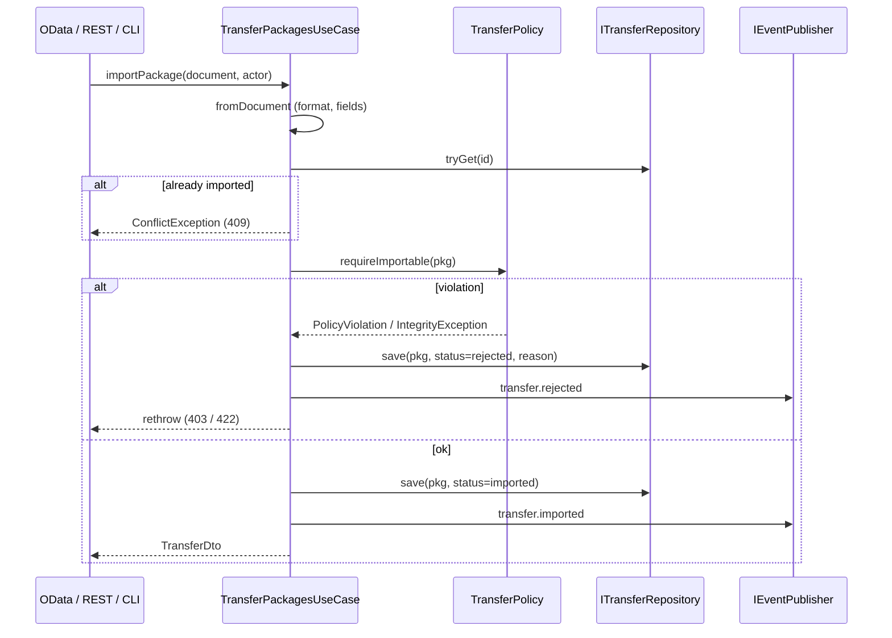

# Neko Service Platform — UML

## Component diagram (hexagonal architecture)

Dependencies point inwards: presentation and adapters depend on ports, ports on
the domain. Only the composition root (`infrastructure/container.d`) knows the
concrete classes.

## Class diagram — domain

## Class diagram — ports and implementations

```mermaid
classDiagram
  class IManageServicesUseCase { <<interface>> }
  class ICheckServiceHealthUseCase { <<interface>> }
  class ITransferPackagesUseCase { <<interface>> }
  class IPlatformOverviewUseCase { <<interface>> }
  class IServiceRepository { <<interface>> }
  class ITransferRepository { <<interface>> }
  class IDocumentStore { <<interface>> }
  class IEventPublisher { <<interface>> }
  class IServiceHealthGateway { <<interface>> }
  class IClock { <<interface>> }
  class IIdGenerator { <<interface>> }

  ManageServicesUseCase ..|> IManageServicesUseCase
  CheckServiceHealthUseCase ..|> ICheckServiceHealthUseCase
  TransferPackagesUseCase ..|> ITransferPackagesUseCase
  PlatformOverviewUseCase ..|> IPlatformOverviewUseCase

  ManageServicesUseCase --> IServiceRepository
  ManageServicesUseCase --> IEventPublisher
  ManageServicesUseCase --> IClock
  ManageServicesUseCase --> IIdGenerator
  CheckServiceHealthUseCase --> IServiceHealthGateway
  TransferPackagesUseCase --> ITransferRepository

  DocumentServiceRepository ..|> IServiceRepository
  DocumentTransferRepository ..|> ITransferRepository
  DocumentServiceRepository --> IDocumentStore
  MemoryDocumentStore ..|> IDocumentStore
  JsonFileDocumentStore ..|> IDocumentStore
  LoggingEventPublisher ..|> IEventPublisher
  HttpHealthGateway ..|> IServiceHealthGateway
  SystemClock ..|> IClock
  UuidGenerator ..|> IIdGenerator
```

## State machine — service life cycle

## Sequence — import with rejection

